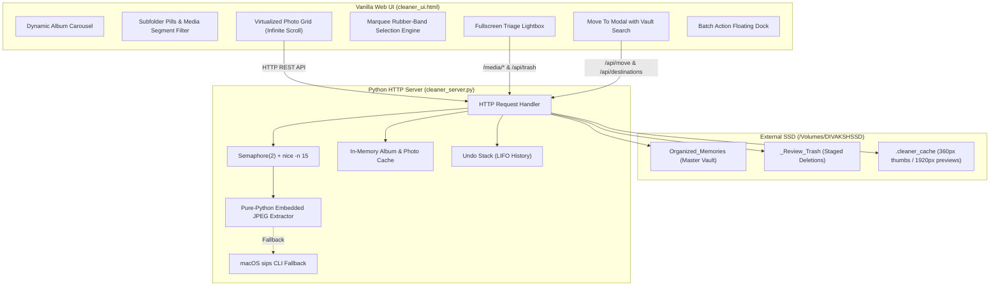
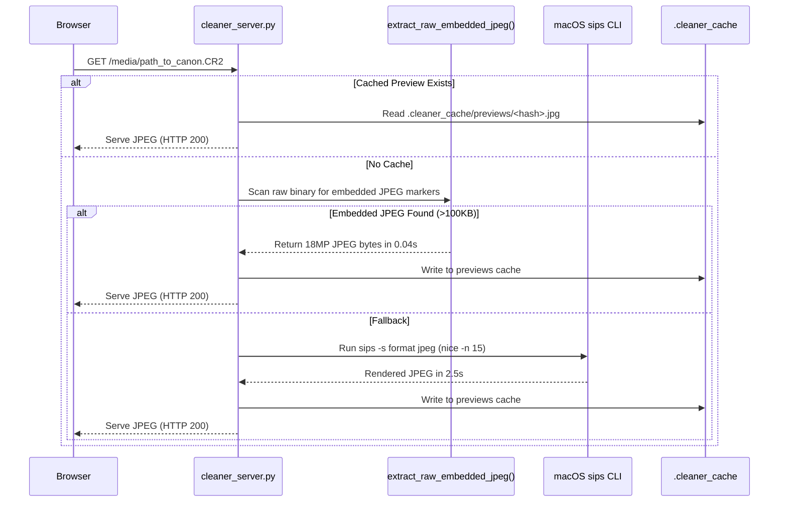

# 📐 Memories Vault Organizer — System Specification Document

- **Document Version**: 2.0.0
- **Target OS**: macOS 11.0+ (Optimized for Apple Silicon M-series & Intel)
- **Primary Vault Location**: `/Volumes/DIVAKSHSSD/Organized_Memories`
- **Application Port**: `http://localhost:8888` (Fallback: `8889-8909`)

---

## 1. System Overview & Objectives

### 1.1 Context
Managing personal media libraries spanning over 15 years (2009–2026) with 95,000+ items totaling over 800 GB presents unique challenges:
- Standard desktop photo managers (e.g., Apple Photos, Google Photos web) choke on tens of thousands of loose files on external ExFAT/APFS SSDs.
- Heavy raw debayering and video transcoding cause severe CPU throttling and fan noise on laptops.
- Accidental deletions during bulk cleanup can lead to irreversible data loss.

### 1.2 Core Goals
1. **High Throughput with Low Thermal Footprint**: Browse and organize tens of thousands of high-res photos and videos silently on Apple Silicon efficiency cores without spinning fans.
2. **Instant Native Curation**: Provide keyboard-driven triage (single-key moves to curated albums, instant staging to trash, 1-key undo).
3. **Hardware-Accelerated RAW Support**: Fast inline rendering of Canon `.CR2`, `.CR3`, and `.DNG` sensor images without debayering latency.
4. **Complete Data Safety**: Non-destructive staged deletions, non-colliding duplicate renames, and atomic filesystem moves.
5. **Zero Cloud Dependency**: 100% offline, local-only processing ensuring complete privacy for family memories.

---

## 2. Component Architecture



---

## 3. Backend Technical Specification (`cleaner_server.py`)

### 3.1 Server Architecture
- **Runtime**: Python 3.9+
- **HTTP Engine**: `socketserver.ThreadingMixIn` combined with `http.server.HTTPServer`.
- **Threading Model**: Daemon threads handling requests concurrently.
- **Port Allocation**: Automatically probes port `8888` through `8909` to handle restarts gracefully without port collisions.

### 3.2 Concurrency & Thermal Throttling
- **Worker Semaphore**: `THUMB_SEMAPHORE = threading.Semaphore(2)`. Only two thumbnail generation or preview conversion tasks are permitted to run concurrently.
- **Process Renicing**: Subprocess conversions run with `nice -n 15` on Apple Silicon efficiency cores, preventing UI stalls and fan spinning.

### 3.3 Fast Memory Caching Layer
- `ALBUM_CACHE`: Stores top-level album summaries and item counts for up to 300 seconds.
- `PHOTOS_CACHE`: Dict mapping `(album_id, subfolder, month)` to photo object lists.
- `invalidate_album_cache()`: Triggered immediately on `/api/trash`, `/api/move`, `/api/create_folder`, `/api/restore`, and `/api/empty_trash`.

### 3.4 REST API Endpoints

#### `GET /` or `GET /index.html`
- Serves the single-page application `cleaner_ui.html` with UTF-8 encoding.

#### `GET /api/albums`
- **Output**:
  ```json
  {
    "albums": [
      { "id": "Ishanvi", "title": "Ishanvi", "icon": "👶", "count": 1189, "has_subfolders": true, "type": "custom" },
      { "id": "Marriage", "title": "Marriage", "icon": "💍", "count": 104, "has_subfolders": true, "type": "custom" },
      { "id": "Trips", "title": "Trips", "icon": "✈️", "count": 15823, "has_subfolders": true, "type": "custom" },
      { "id": "2024", "title": "2024", "icon": "📅", "count": 13089, "has_subfolders": true, "type": "year" },
      { "id": "_Review_Trash", "title": "Trash", "icon": "🗑️", "count": 3601, "has_subfolders": false, "type": "trash" }
    ],
    "active_album": "2026",
    "trash_count": 3601
  }
  ```

#### `GET /api/subfolders?album=<album_id>`
- Returns list of subfolders within the selected album.
- For 4-digit Year albums: Generates month breakdown (`Jan`–`Dec`) and specific trip/event subfolders.
- For Curated/Custom albums: Walks child directories and returns relative paths with counts.

#### `GET /api/destinations`
- Scans all directories across `VAULT_ROOT` up to 3 levels deep.
- Returns sorted list prioritizing curated albums (`Ishanvi`, `Marriage`, `Trips`, `India`...), custom albums, subfolders, and years.

#### `GET /api/photos?album=<id>&subfolder=<sub>&month=<mon>`
- Returns array of media objects in the requested folder:
  ```json
  {
    "photos": [
      {
        "path": "2024/2024-05_May/IMG_1001.heic",
        "filename": "IMG_1001.heic",
        "size_mb": "",
        "location": "Paris France",
        "date_display": "2024-05-12",
        "is_video": false,
        "is_raw": false
      }
    ]
  }
  ```

#### `POST /api/trash`
- **Body**: `{ "paths": ["rel_path_1", "rel_path_2"] }`
- Moves targets to `_Review_Trash/<rel_path>`.
- Appends `(src, dst, "trash")` to `UNDO_HISTORY`.
- Returns `{ "success": true, "trashed": N, "trash_count": total }`.

#### `POST /api/move`
- **Body**: `{ "paths": ["rel_path_1", ...], "target_folder": "Marriage" }`
- Moves targets into `<VAULT_ROOT>/<target_folder>/`.
- Auto-handles name collisions by appending `_1`, `_2`, etc.
- Appends `(src, dst, "move")` to `UNDO_HISTORY`.

#### `POST /api/create_folder`
- **Body**: `{ "folder": "Marriage/Reception" }`
- Creates directory via `os.makedirs(dst_dir, exist_ok=True)`.
- Returns `{ "success": true, "folder": "Marriage/Reception" }`.

#### `POST /api/restore`
- Pops last action from `UNDO_HISTORY`.
- Moves file back to original location and invalidates caches.

#### `GET /thumb/<rel_path>`
- Generates or retrieves 360px JPEG thumbnail from `.cleaner_cache/thumbs/`.
- Served with HTTP 200 and `Cache-Control: public, max-age=604800`.

#### `GET /media/<rel_path>`
- Serves full-resolution media.
- For RAW photos (`.cr2`, `.cr3`, `.dng`): Automatically decodes and serves 1920px hardware JPEG preview.
- Supports HTTP 206 Partial Content (Range requests) for smooth Safari/Chrome video streaming.

---

## 4. Frontend UI Specification (`cleaner_ui.html`)

### 4.1 Rendering & Performance
- **Infinite Virtualized Slicing**: Renders photos in batches of `BATCH_SIZE = 36`. Scrolling down triggers `renderNextBatch()` via requestAnimationFrame.
- **Pure CSS Layout**: Responsive auto-fill grid: `minmax(180px, 1fr)`.
- **Zero Heavy Assets**: Icons rendered using native system emojis and inline SVG vectors.

### 4.2 Selection Engine
- **Single Click Selection**: When in Select Mode, clicking any card toggles selection.
- **Range Selection**: Shift + Click calculates the index span `[min(lastIdx, idx), max(lastIdx, idx)]` and updates state in `Set<string>`.
- **Marquee Drag-to-Select**:
  - Listens to `mousedown` on unselected grid canvas.
  - Dynamically computes bounding rect `(minX, minY, width, height)` on mousemove.
  - Performs 2D AABB (Axis-Aligned Bounding Box) collision detection against all rendered `.photo-card` elements.
  - Automatically scrolls the window when dragging near the viewport boundaries.

### 4.3 Fullscreen Lightbox
- High-resolution modal with black backdrop (`z-index: 200`).
- Supports arrow key cycling, 1-key triage (`I`, `M`, `D`, `Z`), and escape to exit.
- Smooth CSS transform animations on triage actions: `.anim-trash` (downward slide + fade), `.anim-move` (upward slide + fade).

---

## 5. RAW Image Processing Pipeline



---

## 6. Batch Ingestion & Deduplication Pipeline (`ssd-organizer`)

For ingesting massive raw dumps from multiple sources, `ssd-organizer` uses a 3-tier duplicate detection algorithm:

1. **Tier 1 — File Size Matching**: Fast `fs.stat()` indexing. If file size is unique across the entire library, it is guaranteed unique.
2. **Tier 2 — Header Chunk Comparison**: If sizes match, read the first 64 KB of the file. Eliminates 95% of false collisions without reading full gigabyte video files.
3. **Tier 3 — Cryptographic SHA-256 Hash**: Only computed when headers match. Exact duplicate copies are isolated to `_Duplicates/` for safe user review.

---

## 7. Safety, Recovery & Integrity Guarantees

1. **Zero Data Overwrites**: When moving photos with conflicting filenames, destination targets are automatically incremented (`IMG_0001_1.jpg`, `IMG_0001_2.jpg`).
2. **Soft Deletion Staging**: `_Review_Trash/` preserves directory context and timestamps.
3. **ExFAT & APFS Compatibility**: Path sanitization prevents invalid filesystem characters and preserves multi-platform readability.
